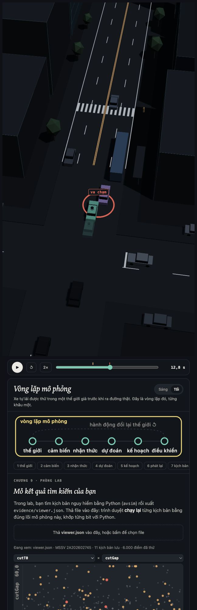
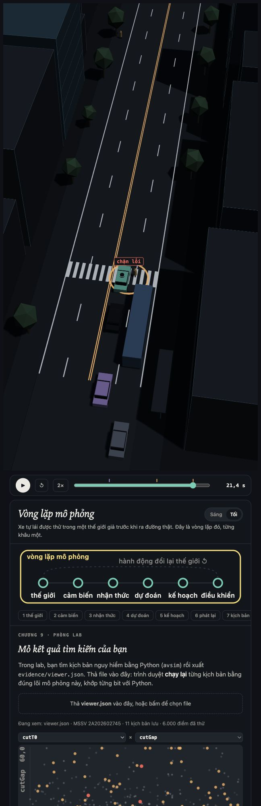
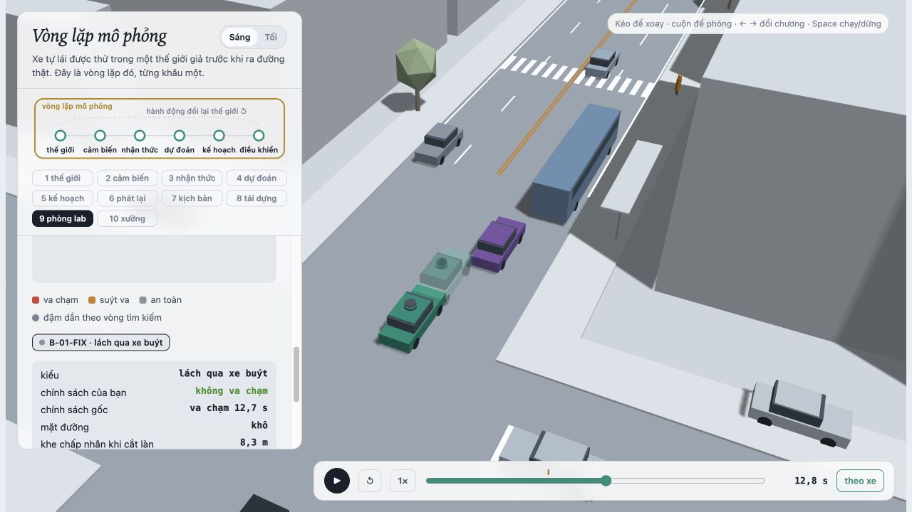
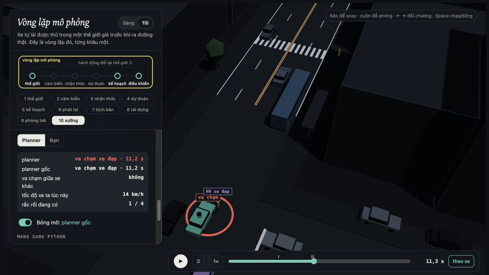

MSSV: 2A202602745

# Lab 11 · Scenario Forge — báo cáo

Thị trấn **D** (`meta.json: _run.town`). Tất cả bằng chứng được chạy với ngân sách đầy đủ, `quick=false`, MSSV nguyên vẹn và seed mặc định; không chỉnh `avsim/`, `run_all.py`, phân phối, seed hay ứng viên policy. 10 TODO đã hoàn thành: 31 test công khai đạt; thêm 10 test Python–JavaScript đạt.

**Chạy lại:** `sh run_submission.sh all`. MSSV có chữ A nên bộ phân tích dòng đầu của `run_all.py` không nhận; script dùng cơ chế `LAB11_MSSV` vốn có của bộ chạy. Khi dùng máy khác, cài môi trường theo `SUBMISSION.md`.

## 1. Phát lại log có trung thực không?

Nguồn: `replay.json: n, dropped_human_crash_logs, n_used, replay, reactive, crash_in_both`.

Trong 400 kịch bản, bỏ 2 log do người lái va chạm, còn 398. Planner trên log phát lại có **92** thất bại: front 0, rear 87, side 5. Thế giới phản ứng có **1**: front 1, rear 0, side 0. Có 1 kịch bản thất bại trong cả hai cách.

Log giữ nguyên quỹ đạo TG đã ghi khi đi sau người lái. Ego của planner giảm tốc khác người lái nhưng TG phát lại không biết để phản ứng lại, nên có thể tông đuôi ego. Những thất bại chỉ xuất hiện khi phát lại là giả theo phép thử phản thực này, không phải bằng chứng planner gây tai nạn trong thế giới phản ứng.

Ví dụ `replay.json: replay_only[0]`, scenario 0, loại rear: planner nhường người đi bộ, TG tiếp tục theo log và chạm ego; trên thế giới phản ứng không có thất bại, `min_ttc_reactive=2.59007` s. Chạy lại riêng R-01 trong trình xem cho tiếp xúc ego–TG lúc 17,5 s; đây là quan sát bổ sung từ kịch bản đã lưu, không phải thống kê một tập mẫu mới.

## 2. Kịch bản bất khả thi

`feasible.is_feasible` loại kịch bản nếu một trong các điều kiện sau xảy ra:

| Luật | Căn cứ |
|---|---|
| `(π/cutDur)² × 3,5/2 > μg` | Đổi làn theo cosine cần gia tốc ngang vượt độ bám đường. |
| `cutBrake > μg` | Lực phanh yêu cầu vượt giới hạn ma sát. |
| `pedV > 2,5 m/s` | Lab mô hình hóa người đi bộ, không phải người chạy. Đây là giới hạn mô hình hành vi. |
| `cutV ≤ 0` hoặc `cutV > 22 m/s` | Miền vận hành của xe đổi làn; không phải giới hạn tốc độ tuyệt đối của mọi xe thật. |

`cutDur ≤ 0` cũng bị loại để tránh thời gian đổi làn không hợp lệ.

Nguồn `hunt.json: <mode>.infeasible`: bus_bypass **2**, cut_in **6**, crosswalk_block **12**, rear_ended **2**. Cuộc săn người đi bộ sinh nhiều kịch bản bất khả thi nhất. CEM ưu tiên điểm nguy hiểm nên có xu hướng kéo tham số về đổi làn nhanh, hành vi cực đoan hoặc chuyển động vượt miền hợp lệ; các luật vật lý chặn hướng tìm kiếm này. Nếu tính các cảnh bất khả thi là thất bại, xác suất sẽ bị nâng lên bởi các sự kiện đường thật không thể tạo ra. Pipeline không mô phỏng chúng; khi ước lượng, chúng không đóng góp thất bại.

## 3. Monte Carlo cho biết gì?

`mc.json`: k = **2**, n = **3000**, p̂ = **0.000666667**, Wilson 95% **[0.000182839, 0.00242768]**; có 8 mẫu bất khả thi. Cả hai thất bại thuộc `bus_bypass`.

Với xấp xỉ hiếm, để nửa độ rộng 95% bằng 20% của p: `n ≈ 1,96²/(0,2²p) ≈ 96/p`. Thay p̂, cần khoảng **144.000** lần chạy (giữ chính xác hệ số thì 144.060). Đây là dự toán theo p̂ rất bất định, không phải bảo đảm độ chính xác.

`cut_in`, `crosswalk_block`, `rear_ended`, `other` chưa xuất hiện. Mỗi kiểu phải báo **cận trên Wilson 0.0012789**, không kết luận xác suất bằng 0. Không thấy sự kiện trong 3.000 lần vẫn tương thích với một xác suất nhỏ nhưng dương.

## 4. Importance sampling, ESS và độ suy biến

Nguồn từng dòng: `estimate.json: seeds[seed].per[mode]`. Đề xuất phòng thủ `q=0,8 q_CEM+0,2 p`; ước lượng `mean(wy)` với `w=p/q`, không tự chuẩn hóa trọng số.

| Seed | Kiểu | p hoặc cận khi chưa thấy | hits | ESS | top_share |
|---|---|---|---|---|---|
| 0 | bus_bypass | 0.00105087 | 40 | 117.58 | 0.3878 |
| 0 | cut_in | chưa thấy; cận 95% ≤ 0.025 | 0 | 127.84 | 0.0000 |
| 0 | crosswalk_block | 3.45125e-07 | 106 | 98.05 | 0.5707 |
| 0 | rear_ended | chưa thấy; cận 95% ≤ 0.025 | 0 | 104.03 | 0.0000 |
| 1 | bus_bypass | 0.000761113 | 27 | 124.41 | 0.3921 |
| 1 | cut_in | chưa thấy; cận 95% ≤ 0.025 | 0 | 132.08 | 0.0000 |
| 1 | crosswalk_block | 2.17772e-07 | 109 | 123.09 | 0.4950 |
| 1 | rear_ended | chưa thấy; cận 95% ≤ 0.025 | 0 | 118.17 | 0.0000 |
| 2 | bus_bypass | 0.000383892 | 22 | 138.08 | 0.3889 |
| 2 | cut_in | chưa thấy; cận 95% ≤ 0.025 | 0 | 102.61 | 0.0000 |
| 2 | crosswalk_block | 2.13368e-07 | 111 | 111.55 | 0.6365 |
| 2 | rear_ended | chưa thấy; cận 95% ≤ 0.025 | 0 | 99.31 | 0.0000 |

`estimate.json: seeds[*].total` lần lượt **0.00105122, 0.00076133, 0.000384105**; trung vị **0.00076133**. Seed lớn nhất khoảng **2.74 lần** seed nhỏ nhất. Cả ba tổng nằm trong Wilson MC, nhưng các khoảng đều rộng nên chưa thể nói các seed xác nhận một giá trị chính xác.

`crosswalk_block` có top_share > 0,5 ở seed 0 (**0,5707**) và seed 2 (**0,6365**): hơn nửa ước lượng đến từ một mẫu. Seed 1 sát ngưỡng (**0,4950**). Vì vậy nhiều hits không đồng nghĩa có nhiều quan sát hữu ích theo phân phối tự nhiên. ESS khoảng 98–138 cũng cho thấy trọng số không đều. Top_share thấp hơn không chứng minh không bỏ sót vùng thất bại.

`estimate.json: budget=16800` gồm 9.600 mẫu săn và 7.200 mẫu ước lượng. So với khoảng 144.000 mẫu MC cho ±20% tại p̂, ngân sách nhỏ hơn 8,57 lần, **nhưng IS hiện chưa đạt ±20%**. Riêng bus_bypass seed 0 có nửa khoảng xấp xỉ bằng 87% của p, seed 1 khoảng 95%, seed 2 khoảng 97%. MC để có sai số chuẩn tương đương ba ước lượng bus này cần xấp xỉ 4.825, 5.605, 10.732 mẫu, theo `p(1-p)/se²`. Do đó kết quả này chưa chứng minh IS tiết kiệm tổng ngân sách cho cùng độ chính xác của tổng. Với crosswalk_block, p cỡ 2–3,5×10⁻⁷ đòi hỏi MC cỡ 2,8–4,5×10⁸ mẫu cho ±20%, nhưng IS cũng rất suy biến nên không thể dùng riêng con số đó làm chứng nhận.

`estimate.json: other` lấy từ MC: k=0, n=3000, cận trên 0.0012789. Không săn `other` vì nó là phần dư gồm cơ chế khác nhau, chưa có điểm nguy hiểm riêng. Cộng phần dư giúp không bỏ sót tập va chạm ngoài bốn nhãn.

Hai kiểu IS không có hits phải báo `upper_zero_hits=3/(0,2×600)=0,025`, không dùng `3/ESS`. Các `total` và `hi` được bộ chạy xuất là tổng ước lượng và khoảng xấp xỉ; chúng **không cộng hai cận không-hits này**, nên không diễn giải là cận bảo thủ cho mọi kiểu chưa quan sát. Thêm nữa khoảng chuẩn IS có thể quá hẹp khi một mẫu quyết định kết quả.

Săn quá lâu làm q co hẹp quanh những thất bại đã biết. IS với trọng số đúng vẫn không chệch về lý thuyết, nhưng trong ngân sách hữu hạn, vùng có đóng góp có thể không được lấy mẫu nên nhiều lần chạy cho ước lượng thấp. README cảnh báo mức thấp hơn khoảng 1,5–4 lần là hiện tượng thường gặp trong lab, **không phải hệ số hiệu chỉnh đo được cho MSSV này**; không nhân kết quả lên để sửa xác suất. Bộ chạy lưu đề xuất đầu tiên đạt elite level ≥ −0,001: `hunt.json: bus_bypass.stopped_tightening=true`; ba cuộc săn còn lại có `stopped_tightening=false`, chưa đạt tiêu chí đó. Cuộc săn tìm một đường dẫn tới thất bại dễ tối ưu, không chứng minh đó là cơ chế có xác suất tự nhiên lớn nhất. Cần nhiều đề xuất rộng và seed độc lập để kiểm tra vùng bị bỏ sót.

## 5. Các kiểu thất bại

Nguồn `hunt.json: <hunt>.found`:

| Cuộc săn | Các thất bại tìm được |
|---|---|
| bus_bypass | bus_bypass 76 |
| cut_in | bus_bypass 14; không có cut_in |
| crosswalk_block | bus_bypass 2; crosswalk_block 29 |
| rear_ended | bus_bypass 1; crosswalk_block 1; không có rear_ended |

**Lách xe buýt — B-01**, trong `viewer.json: runs`: C2 muốn vượt xe buýt đang đỗ, chờ khe rồi lấn về làn ego; ego nhận C2 là xe dẫn quá muộn và phanh gấp nhưng tiếp xúc lúc **12,65 s**. Chạy lại kịch bản cho C2 ở x≈95,73 m, v≈0,40 m/s, đúng miền `bus_bypass`. Ảnh chụp sau tiếp xúc 0,1 s để vòng đánh dấu hiển thị rõ.

**Chặn lối người đi bộ — C-01**: P1 không ngó qua xe buýt, chỉ bước khi khe mà mình nhìn thấy đủ xa; ego phanh trên đường ướt nhưng dừng với thân xe nằm trên vạch ở x=122 m. P1 đứng chờ thay vì bước vào xe. `kind=block` lúc **21,4 s**, không phải tiếp xúc vật lý. Ảnh chụp ở 21,45 s.

Các thời gian và tọa độ trên là quan sát chạy lại các kịch bản đã xuất, không phải số liệu tổng hợp thêm vào hunt. Không tìm thấy cut_in và rear_ended trong ngân sách này chỉ nói thuật toán chưa tìm được, không chứng minh chúng không thể xảy ra. Cuộc săn cut_in thực tế bị kéo về bus_bypass; nếu chỉ săn chung, các kiểu dễ đạt điểm cao sẽ chiếm elite và làm mất độ đa dạng. Săn riêng giúp tìm cơ chế người đi bộ, nhưng vẫn không bảo đảm bao phủ tất cả kiểu.

## 6. Sửa planner

`fix.json: chosen.policy={"cutinLat": 2.6}`, được chọn chỉ bằng TRAIN, cận trên nhỏ nhất trong các hàng giữ ít nhất 95% quãng đường gốc; hòa điểm với cutinLat=3,0 và 3,3 thì chọn hàng có tiến độ cao hơn. Ngưỡng quãng đường TRAIN là **206.650613 m**. TEST dùng seed mới, cuộc săn mới nhắm từng policy, và 3.000 mẫu tự nhiên riêng.

Nguồn bảng: `fix.json: baseline_train, chosen, baseline_test, chosen_test`. `harsh` là **số khung hình** gia tốc < −3 m/s² trung bình mỗi kịch bản, không phải số lần phanh độc lập.

| Policy / tập | fail | fail_hi_seen | fail_hi | Quãng đường (m) | Khung phanh gấp |
|---|---|---|---|---|---|
| Gốc TRAIN | 0.000308931 | 0.000620941 | 0.000620941 | 217.526961 | 7.898438 |
| Chọn TRAIN | 7.72451e-08 | 1.41002e-07 | 1.41002e-07 | 217.639777 | 7.695312 |
| Gốc TEST | 7.23332e-05 | 0.000132983 | 0.00141188 | 215.809267 | 8.175667 |
| Chọn TEST | 1.82124e-06 | 5.06385e-06 | 0.00128396 | 215.792724 | 7.942333 |

Trên TRAIN, bus_bypass của ứng viên là `unseen`, không đủ để chứng nhận kiểu đó đã biến mất. TEST tìm thấy 2 hits bus_bypass ở bản sửa. Point estimate TEST giảm khoảng **39.72 lần**, quãng đường giảm **0.0077%**; không chọn lại policy sau khi nhìn TEST.

`fail_hi` của bản sửa (**0.00128396**) lớn hơn `fail` gốc (**7.23332e-05**) vì cộng cả bất định của thất bại khác: trên 3.000 mẫu tự nhiên, `other_crashes.k=0` vẫn để lại Wilson hi=0.0012789. Trong lần chạy này TEST không có hunted mode unseen; nếu có, mỗi kiểu đó phải cộng cận 0,0375 với n=400. `fail_hi_seen` nhỏ hơn rất nhiều nhưng không thay thế cận cho policy. Các thành phần IS vẫn có khoảng chuẩn xấp xỉ; “valid” là nhãn bộ chạy dùng, không chứng minh phủ đúng 95% khi IS suy biến. TEST crosswalk_block có `top_share=0,9110`, cần thêm mẫu/đề xuất rộng hơn trước khi tin mức giảm là ổn định.

Ảnh B-01 ở câu 5 giữ cách xuất mặc định: xe tô đặc là policy gốc, bóng mờ là bản sửa. Để đáp ứng đúng yêu cầu ảnh bản sửa với bóng mờ policy gốc, có thêm `evidence/viewer-fix-comparison.json`: cùng params B-01, policy cấp file là cutinLat=2,6, run.policy=null, baseline_policy={} nên xe tô đặc là bản sửa và bóng mờ là policy gốc. File bổ sung chỉ dùng phát lại so sánh, không thay bộ evidence do pipeline sinh hay số thống kê TRAIN/TEST. Chạy lại B-01 xác nhận bản sửa không có thất bại ego, còn policy gốc tiếp xúc C2 lúc 12,65 s.

Một núm nghe an toàn hơn nhưng phản tác dụng: **T=2,0** tăng fail TRAIN từ 0.000308931 lên **0,000988587** (`fix.json: table`, hàng policy T=2,0). Xe ego nhường nhiều hơn, mở khe khác để C2 đổi làn/lách xe buýt; phản ứng của giao thông có thể đưa ego vào tình huống nguy hiểm khác. Đây là giải thích cơ chế phù hợp mô hình, không khẳng định đã tách riêng hiệu ứng nhân quả từng tác nhân. **cautionV=6,5** cũng tăng fail TRAIN tới 0,000920147 và mất hơn 5% tiến độ; chậm hơn không tự động an toàn hơn.

Kiểm tra bổ sung trên một kịch bản khả thi lấy lại từ đề xuất TRAIN bus_bypass bằng seed TRAIN gốc (`evidence/t2-train-example.json`, không phải một ước lượng tỉ lệ mới): policy gốc không có thất bại ego, C2 bắt đầu lấn làn lúc 17,7 s; với T=2,0, C2 bắt đầu lấn lúc 10,6 s và tiếp xúc ego lúc 13,1 s. Ở khung tiếp xúc của T=2,0, ego gốc đã tới x≈95,45 m còn ego T=2,0 ở x≈91,21 m. Việc nhường xa hơn làm thay đổi vị trí tương đối và khe mà C2 chấp nhận, khiến C2 lấn sớm hơn trong cảnh này. Đây là một ví dụ quan sát trực tiếp về thế giới phản ứng lại policy; không dùng kịch bản đó để chọn lại ứng viên.

## 7. Từ mô phỏng ra đường thật

Thị trấn D dùng wet=0,15, pedLook=0,90, xác suất phanh sau nhập làn 0,20, median cutGap=14 m (`space.py: VARIANTS`). Đây là giả định dạy học.

| Giả định cần thay | Dữ liệu thật và nơi lấy | Hướng sai lệch nếu giả định sai |
|---|---|---|
| Khe xe đổi làn chấp nhận là lognormal, median 14 m | Trích quỹ đạo, khe trước/sau và thời điểm bắt đầu đổi làn từ video tuyến mục tiêu; NGSIM là nguồn tham khảo phương pháp, rồi hiệu chỉnh bằng video quanh bến xe buýt ở địa phương. | Khe thực nhỏ hơn có thể làm nhiều lượt lấn nguy hiểm hơn, nên mô phỏng đánh giá thấp bus_bypass/cut_in. Hướng tổng phải kiểm tra vì tương tác có thể đổi dấu. |
| 90% người đi bộ ngó qua xe buýt | Quay video cố định tại bến có vạch, gán nhãn tư thế/ngó ra, thời điểm bước và xe nhìn thấy; chia theo kích thước xe buýt, nhóm tuổi, mật độ giao thông. Cần thu trực tiếp, quỹ đạo không đủ suy ra việc họ nhìn. | Nếu ít người nhìn hơn giả định, khả năng bước từ vùng bị che và chặn vạch có thể cao hơn, mô phỏng đánh giá thấp crosswalk_block. |
| Đường ướt xác suất 0,15 và μ chỉ có 0,5/0,8 | Nhật ký chuyến xe ghép tình trạng mưa/ướt trên tuyến, đo ma sát trên mặt đường và điều kiện lốp; dùng hướng dẫn FHWA để chọn phương pháp đo. | Nếu gặp đường ướt nhiều hơn hoặc μ thấp hơn, quãng phanh thực dài hơn, nên mô phỏng có thể đánh giá thấp thất bại. |

[NGSIM của FHWA](https://ops.fhwa.dot.gov/trafficanalysistools/ngsim.htm) cung cấp bộ dữ liệu quỹ đạo và tài liệu; [fact sheet](https://www.fhwa.dot.gov/publications/research/operations/its/06135/index.cfm) mô tả ghi vị trí xe mỗi 0,1 s. Không mặc định dữ liệu đường Mỹ đại diện cho bến xe buýt Việt Nam. [Hướng dẫn đo ma sát FHWA](https://www.fhwa.dot.gov/pavement/t504038.cfm) mô tả các phương pháp đo, cần ghép với điều kiện tuyến và lốp thực tế. Các hướng sai lệch trong bảng là suy luận từ cơ chế mô phỏng, cần thực nghiệm xác nhận.

## 8. Giới hạn

1. Chỉ một đoạn phố, hình học và 24 s: xác suất không đại diện cho toàn bộ chuyến đi, cao tốc hay mọi giao lộ.
2. Xe khác phản ứng bằng IDM và gap acceptance cố định; thiếu sự phân tâm, tín hiệu giao tiếp, hành vi hung hăng và phản ứng người lái phong phú.
3. Cảm biến gần như hoàn hảo ngoài che khuất bởi xe buýt; chưa mô hình hóa bỏ sót, sai nhận dạng, trễ đo, thời tiết làm hỏng cảm biến hoặc sai định vị.

Nếu có thêm một tuần: thu video địa phương để hiệu chỉnh cutGap/pedLook, quét ma sát và độ trễ cảm biến, tăng ngân sách cho crosswalk_block trên nhiều đề xuất/seed rồi kiểm tra độ phủ khoảng tin cậy bằng một tổng điều tra mô phỏng lớn. Không dùng các ước lượng hiện có làm xác suất tai nạn ngoài đời.

## 9. Rắc rối tự thiết kế

**Tình huống:** xe đạp đi mép làn ngoài rồi lạng sang trái vào vùng ego đang đi, giống tránh vật cản bất ngờ. Cảnh được dựng trong chương 10; `hazard.json` giữ nguyên format, params, policy, hazards từ cảnh. Xe đạp ở x=40 m, E2, lệch phải 0,6 m, v=4 m/s, lạng 3,6 m trong 2,5 s khi ego cách 10 m. Planner gốc chạm H0 lúc **11,2 s** (`mine.json: exact.planner`).

**Căn cứ nghi ngờ planner:** xe đạp ban đầu lệch ngoài vùng leader của ego; logic coi leader theo khoảng ngang có thể đợi quá lâu trước khi phanh. Kết quả oracle bên dưới kiểm chứng rằng phanh sớm hơn có thể tránh các va chạm, nhưng chưa chứng minh một planner khả thi sẽ luôn nhận đúng ý định lạng.

**Giả định và căn cứ miền quét** (`hazard.json: space, why`): x 35–45 m, ngưỡng kích hoạt 5–15 m, lạng 3,2–3,79 m, thời gian 2,5–2,8 s. Đây là lân cận thử nghiệm quanh cảnh cụ thể, thiết kế từ hình học làn E2 z=5,25 m và offset +0,6 m: cuối lạng z=2,06–2,65 m, sát vùng xe ego. Theo cosine, gia tốc ngang lớn nhất `π²×3,79/(2×2,5²)≈2,99246 m/s²`, dưới giới hạn 3. Không có cảnh trùng thân xe lúc bắt đầu.

`world="scene"` giữ giao thông cảnh, **không phải giao thông ngẫu nhiên thị trấn D**. `exposure=null` thể hiện chưa có số liệu tần suất mỗi chuyến; không lấy số lần chủ động thêm hazard vào cảnh để thay thế tần suất này. Bộ chạy cho phép không có exposure khi chỉ phân tích cảnh, nhưng **phần này chưa đáp ứng yêu cầu rubric về exposure có căn cứ và giá trị trong (0, 1]**. Các khoảng quét là giả định stress test có căn cứ hình học/vật lý, chưa được fit bằng dữ liệu xe đạp thật.

[BSafe-360](https://pmc.ncbi.nlm.nih.gov/articles/PMC10385114/) trình bày cách thu dữ liệu cảm biến và nhận diện hành vi lạng. [Dozza và Werneke, 2014](https://doi.org/10.1016/j.trf.2014.04.001) liên hệ mặt đường bảo trì kém với sự kiện nguy hiểm trong nghiên cứu xe đạp tự nhiên. Hai nguồn hỗ trợ lựa chọn tình huống và phương pháp thu dữ liệu; chúng không xác nhận miền lạng 3,2–3,79 m hoặc exposure của cảnh này. Không quy đổi tỷ lệ sự kiện nguy hiểm chung thành tần suất xe đạp lạng vào làn ego.

**Kết quả** (`mine.json: baseline, chosen`), `accepted=1`, 1.500/1.500 cảnh khả thi; `conditional_on="your scene's traffic only"`:

| Policy | n | avoidable | unavoidable | unattributed | low_speed | avoidable_foreknown | P(lỗi \| cảnh có rắc rối), Wilson 95% |
|---|---|---|---|---|---|---|---|
| Gốc | 1500 | 1039 | 0 | 0 | 0 | 1039 | 0.692667 [0.668850, 0.715499] |
| cutinLat=2.6 | 1500 | 829 | 0 | 0 | 8 | 829 | 0.552667 [0.527401, 0.577663] |

Bản sửa giảm số lỗi tránh được từ 1.039 xuống 829: **210** trường hợp ít hơn, giảm **20.21%** tương đối, nhưng vẫn thất bại trong nhiều biến thể. `low_speed=8` của bản sửa là va chạm khi ego <1 m/s, nằm trong nhóm avoidable đã đếm, không cộng thêm vào tổng. `avoidable_foreknown` bằng avoidable ở cả hai policy nên phép thử này không cho thấy tổn thất thêm do che khuất.

**Tần suất mỗi chuyến:** chưa suy ra được. Vì `world=scene`, bộ chạy không xuất `per_trip`; không nhân tỷ lệ 0,692667 hoặc 0,552667 với exposure để so với bus_bypass. Ước lượng bus_bypass trong thị trấn có trung vị **0,000761113** (`estimate.json`), nhưng hai số thuộc hai mẫu số/điều kiện khác nhau. Muốn đặt cạnh nhau cần đo exposure từ số lượt xe đạp lạng trên tổng chuyến tại tuyến thật và quét rắc rối trong giao thông thị trấn đã hiệu chỉnh. Đây là phần dữ liệu ngoài đời còn thiếu, không bịa một tần suất để tăng điểm.

**Phân loại:** avoidable là không còn bất kỳ va chạm ego nào nếu cùng planner bắt đầu phanh tối đa ngay khi rắc rối đã hoạt động và được nhìn thấy; unavoidable vẫn va chạm với phép thử phanh đó; unattributed chưa quy được cho rắc rối, nên không coi là lỗi do xe đạp. Không có hai nhóm sau trong quét này.

**Vì sao chuẩn này lạc quan:** oracle biết ngay rắc rối khi nhìn thấy và phanh tối đa, không có độ trễ nhận diện/quyết định, nên avoidable có thể đếm nhiều hơn số vụ một planner thật tránh được. Ngược lại chỉ thử phanh, không đánh lái, bỏ qua những vụ tránh được bằng đổi hướng; hai hướng sai lệch cần cùng được nêu. Không hiểu “unavoidable” là không thể tránh bằng mọi thao tác.

**Tự lái:** chưa thử cầm lái; không ghi thành tích người lái do mình chưa đo. Oracle phanh tối đa không được coi là kết quả tự lái.

**Cách sửa:** cutinLat=2,6 nhận tác nhân lệch ngang sớm hơn nhưng chưa đủ (829 lỗi). Đề xuất thêm dự đoán hành lang tương lai của xe đạp từ vị trí/vận tốc ngang và footprint ego, kiểm tra quãng phanh theo μg, phanh trước khi xe đạp chính thức vào ngưỡng leader. Cần thử riêng các biến thể và kiểm tra phanh giả, tiến độ, phản ứng TG; chưa khẳng định một núm mới chắc chắn sửa được vì chưa chạy phép thử đó.
